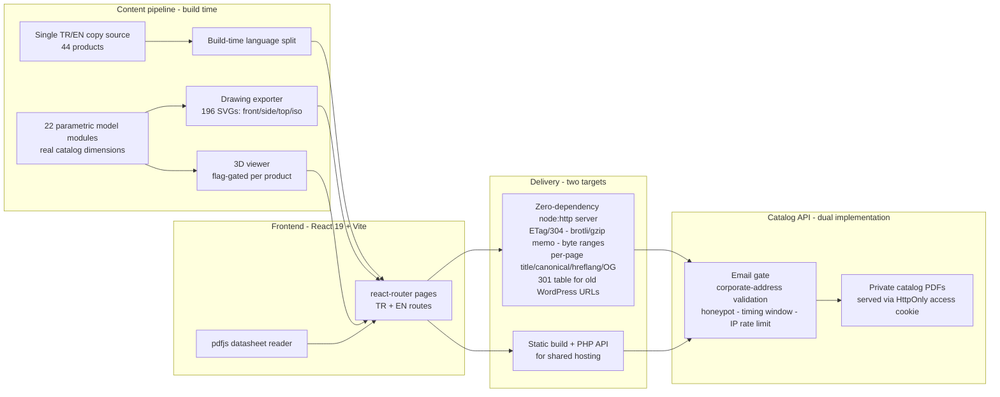

# Parametric 3D product catalog — case study

A multilingual (Turkish/English) product showcase and catalog site built for a stainless-steel buffet & hospitality equipment manufacturer in Istanbul, replacing their aging WordPress site. 44 products are served from a single content source, each with a code-defined parametric 3D model, four auto-generated technical drawing views, an in-browser datasheet reader, and an email-gated catalog download — all delivered on a zero-dependency Node production server with a PHP fallback for static hosting.

> **Note:** This is client work, so the source code is private. This repository documents the problem, architecture, and engineering decisions.

**At a glance**

- 44 products × 2 languages from one content pipeline (build-time TR/EN split, no runtime i18n library)
- 22 parametric three.js model modules covering the full catalog via variants, built from real catalog dimensions and gastronorm standards
- 196 SVG technical drawings (front/side/top/isometric) generated automatically by a 119-line export script
- 556-line production web server on plain `node:http` — ETag/304, in-memory brotli/gzip, byte-range 206, per-page SEO head injection, 301 redirect table
- Email-gated catalog API with layered anti-abuse checks, implemented twice: Node and PHP (for static shared hosting)

---

## Problem

The client manufactures stainless-steel buffet equipment (trolleys, display stands, risers, mobile bars) and sells on a quote basis — no e-commerce, but buyers need precise specs: dimensions, materials, technical drawings, and PDF datasheets.

The existing WordPress site had three structural problems:

1. **Content duplication.** Turkish and English pages were maintained by hand as separate WordPress pages, drifting out of sync.
2. **No technical depth.** Buyers of commercial kitchen equipment decide on dimensions and standards compliance; the old site offered only photos and prose.
3. **Lead leakage.** The PDF catalog was either fully public (no lead capture) or emailed manually.

Constraints that shaped the build:

- The client's hosting options range from a small VPS to plain PHP shared hosting — the solution had to run on both.
- Hundreds of old WordPress URLs were indexed and had to keep working.
- Products are simple geometric assemblies (tubes, sheets, trays) — ideal for code-defined geometry rather than heavy exported meshes.

## Architecture

Key decisions:

**Parametric 3D instead of exported meshes.** Each product family is a small JavaScript module that builds three.js geometry from the real catalog measurements (gastronorm pan sizes, tube diameters, shelf pitches), with page-referenced dimension comments in the source. 22 modules cover 44 products through named variants. This keeps the 3D payload tiny, makes dimension changes a one-line edit, and — crucially — lets the same geometry drive two outputs: the interactive viewer and the drawing exporter.

**Drawings as a build artifact.** A single export script projects every model into front, side, top, and isometric SVG views — 196 drawings regenerated on demand. No CAD round-trip, no drift between the 3D model and the technical drawing: they are the same code.

**Bundle discipline via flags, not routes.** An audit showed the ~609 kB WebGL engine chunk loading on dozens of product pages that didn't need it. The fix was a per-product `stage3d` flag: only the handful of flagship products (trolleys, mobile buffets, bars) load three.js; everything else gets the generated drawings and photography. Browsers without WebGL get a poster fallback.

**A production server with zero npm dependencies.** The site is served by a single-file `node:http` server: ETags with 304 handling, text assets compressed once (brotli/gzip) and memoized in memory, single byte-range 206 responses for PDF datasheets and model files, per-page `<head>` injection (title, canonical, TR/EN `hreflang`, Open Graph, LCP preload) for crawlers, and a JSON-driven 301 table mapping every old WordPress permalink to its new address.

**Dual-runtime lead gate.** Catalog downloads require a corporate email address. The validation stack — free-mail domain blocklist, honeypot field, a plausibility window on form age, per-IP rate limiting, and an HttpOnly access cookie for the private PDFs — is implemented twice with identical behavior: once in the Node server, once in plain PHP so the same site can be deployed to static shared hosting with no Node process at all.

**Design system with an evidence-based audit.** The visual language follows a luxury-retail reference brand (serif display type, hairline rules, square shadowless components, a single warm gold accent). Before the redesign pass, I wrote a ~25 KB self-audit where every finding cites file and line, including WCAG contrast math that caught the gold accent failing on white and forced a darker ink variant for text use.

## My role

Sole developer, end to end:

- Information architecture, design-token system, and the written redesign audit
- All 22 parametric model modules and the SVG drawing export pipeline
- React frontend (routing, TR/EN build-time content split, pdfjs datasheet reader, WebGL gating and fallbacks)
- The zero-dependency production server and the PHP mirror of the catalog API
- Deployment tooling for both targets and the legacy-URL redirect map
- Secrets handling for the repository (git-crypt)

## Stack

| Layer | Technology |
|---|---|
| Frontend | React 19, react-router 7, Vite 8 |
| 3D | three.js (parametric geometry in code, flag-gated loading) |
| Documents | pdfjs-dist in-browser datasheet reader |
| Drawings | Custom Node exporter → static SVG (4 views per product) |
| Server | Plain `node:http` (zero runtime dependencies) |
| Static fallback | Prebuilt static site + PHP API |
| Secrets | git-crypt |

## Results

- **44 products in 2 languages** published from a single content source; adding a product touches one data entry, not two page trees.
- **196 technical drawings** generated automatically — zero manual drafting, guaranteed consistency with the 3D models.
- **~609 kB of WebGL engine removed** from roughly 85% of product pages by gating 3D behind an explicit per-product flag.
- **Zero npm runtime dependencies on the server** — the entire production delivery layer is one auditable 556-line file.
- **Two deployment targets from one codebase**: Node daemon on a VPS, or static files + PHP on commodity shared hosting, with the lead gate working identically on both.
- **Legacy SEO preserved**: every indexed WordPress URL answers with a 301 to its new TR or EN address; every page ships canonical + hreflang pairs.

## Lessons learned

- **For small geometric catalogs, parametric code beats asset pipelines.** Modeling products as code with real catalog dimensions produced the viewer *and* the drawings from one source, and made the catalog maintainable by diff review instead of a DCC tool.
- **Gate heavy chunks by capability flag, not by page type.** "This route has a product, so load the engine" quietly shipped 609 kB to pages that rendered a static image. An explicit per-product flag made the cost visible and opt-in.
- **A bare `node:http` server is a feature, not a dare — within scope.** ETags, memoized compression, byte ranges, and head injection fit comfortably in ~550 lines. The discipline is saying no to everything else (no middleware, no templating, no plugins).
- **Dual-runtime APIs are cheap insurance for small clients.** Writing the lead gate twice (Node + PHP) cost a day and removed hosting as a constraint on the client's budget decisions.
- **Audits need file:line evidence.** Writing the redesign audit with every claim pinned to a file and line (including contrast ratios computed, not eyeballed) turned subjective design debates into a checklist — and caught an accessibility failure in the brand accent color before it shipped.
- **Build-time i18n splitting is enough for a two-language brochure site.** Splitting TR/EN copy at build time avoided a runtime i18n library entirely and kept each language bundle lean.
